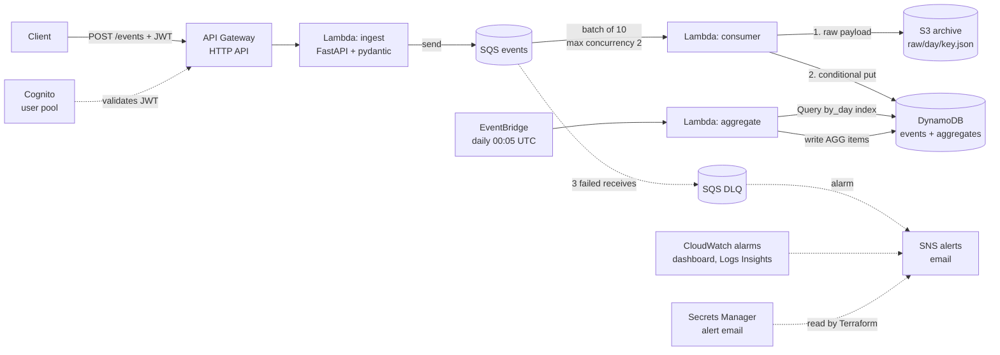

# aws-ingestion

A serverless event ingestion pipeline on AWS, built entirely with Terraform in `eu-central-1`.
Devices (simulated) post small measurements to an authenticated API. The events are queued,
stored exactly once, archived raw, and summarised daily. Synthetic data only.

It is a portfolio project for the AWS Solutions Architect Associate exam. The interesting part
is not the happy path but the decisions and failures behind it: see [DECISIONS.md](DECISIONS.md)
(38 entries: choice, alternatives, reason) and [WHAT_BROKE.md](WHAT_BROKE.md) (23 real problems
and fixes).

## Architecture



Cross-cutting: least-privilege IAM (one role per function), X-Ray tracing, JSON logs, API access
logs, GitHub Actions deploying through OIDC (no stored AWS keys).

## How a request flows

1. **API Gateway + Cognito.** The caller sends an ID token. Requests without a valid token get `401` before any code runs.
2. **Ingest Lambda.** Validates the body (`422` on bad input), derives an idempotency key from `(device_id, kind, recorded_at)`, enqueues, and answers `202`. If SQS fails it returns `503` with `Retry-After`; retrying is safe.
3. **SQS + DLQ.** Absorbs bursts. A message that fails 3 times moves to the DLQ and raises an alarm.
4. **Consumer Lambda.** Writes the raw payload to S3 first (overwrites are harmless), then does a conditional `PutItem`. A redelivered event hits the condition and is skipped, so the same event delivered twice creates no duplicate. Only failed records of a batch are retried.
5. **Daily aggregation.** EventBridge runs the aggregate Lambda for the previous UTC day: count, min, max and average per device and kind, written under deterministic keys so reruns overwrite.

## Repository layout

| Path | What |
|---|---|
| `bootstrap/` | State bucket, budget, alert topic, GitHub OIDC roles. Applied once, never destroyed. |
| `infra/` | Everything else. Remote state in the bootstrap bucket. Destroyed after each session. |
| `src/` | Lambda code: `ingest`, `consumer`, `aggregate` |
| `tests/` | moto unit tests (15) |
| `scripts/` | `build_lambda.sh`, `smoke_test.sh`, `load_test.py`, `redrive_dlq.sh`, `eod.sh` |
| `.github/workflows/` | Plan on pull request, manual apply/destroy |

## Run it

Prerequisites: Terraform >= 1.10, [uv](https://docs.astral.sh/uv/), AWS CLI with IAM (non-root) credentials.

```bash
# once: alert email lives in Secrets Manager, never in git
aws secretsmanager create-secret --name aws-ingestion/alert-email --secret-string "you@example.com"
terraform -chdir=bootstrap init && terraform -chdir=bootstrap apply

# each session
echo 'bucket = "aws-ingestion-tfstate-<ACCOUNT_ID>"' > infra/backend.hcl   # gitignored
for p in ingest consumer aggregate; do scripts/build_lambda.sh $p; done
terraform -chdir=infra init -backend-config=backend.hcl
terraform -chdir=infra apply

scripts/smoke_test.sh                     # 401, 422, 202 twice, exactly one stored item
uv run python scripts/load_test.py --workers 4

terraform -chdir=infra destroy            # always, after the session
```

## Testing

- **Unit (moto):** `uv run pytest -q`. Handler logic, idempotency, partial batch failure, aggregation.
- **Smoke test:** against the deployed stack. Covers what moto cannot: IAM, the JWT authorizer, the event source mapping.
- **Load test:** 1000 posts including duplicates; checks no loss, no duplicate, empty DLQ. Results below.
- **CI:** every pull request runs the tests, `terraform fmt/validate/plan` (read-only role) and a checkov policy scan with documented skips.

## Security

- No AWS keys anywhere. GitHub Actions assumes roles through OIDC. Pull requests get a read-only role; only `main` can assume the apply role, which is scoped to `aws-ingestion-dev-*` resources and cannot attach arbitrary policies (privilege-escalation guard).
- One IAM role per Lambda. The ingest role can only send to the queue.
- Every wildcard is commented with its reason (X-Ray write, Describe/List calls, event source mappings).
- Repo is public: no account IDs, keys or real data. The state bucket name is passed from a gitignored file.

## Load test results

1000 posts (800 unique + 200 duplicates), warm functions:

| Clients | Outcome |
|---|---|
| 4 | all `202`, p95 80 ms, 800 stored, DLQ empty |
| 20, client retries 503 | all 1000 accepted (356 retries), p95 827 ms, exactly 800 stored |
| 8, no retries | 38% `503`; everything accepted was stored exactly once |

Finding: the account's total Lambda concurrency limit is **10**. The consumer scaling up starved the
API Lambda, so the consumer is capped at 2 and a Throttles alarm exists (throttles do not show in the
`Errors` metric). Cold start is about 3.9 s; warm requests about 60 ms.

## Cost estimate

Rough, **order-of-magnitude** figures for `eu-central-1` using list prices as I understand them
(Nov 2026); check the [AWS Pricing Calculator](https://calculator.aws/) before relying on them.
Assumes 256 MB Lambdas, ~60 ms ingest, batches of 10, ~1 KB events, Free Tier ignored.

| Per 1M events | Approx. USD | Note |
|---|---|---|
| API Gateway (HTTP API) | 1.1 | per request |
| Ingest Lambda | 0.5 | requests + ~15k GB-s |
| SQS | 0.5 | send + batched receive/delete |
| Consumer Lambda | 0.2 | 100k invocations |
| DynamoDB writes (on-demand) | 1.5 | 1 write per event |
| **S3 PUTs** | **5.4** | **one object per event, the biggest line** |
| CloudWatch Logs | 0.5 | ~1 KB of logs per event |
| **Total** | **~10** | |

Fixed monthly: Secrets Manager ~0.40, CloudWatch alarms ~1 (about 10 at 0.10), first three dashboards free.
While destroyed (the normal state between sessions) only the secret and a nearly empty state bucket remain. A $10 monthly budget with
50% actual and 100% forecast alerts guards the account.

## Scaling to 10x and beyond

What breaks first, in order, and the fix:

1. **Lambda concurrency limit (10).** Request a Service Quotas increase, then raise the consumer cap above 2.
2. **S3 cost and PUT rate.** One object per event dominates cost. Write one object per consumer batch, or put Kinesis Data Firehose in front of S3.
3. **`by_day` index hot key.** Every event of a day shares one index partition key, which is limited to about 1000 writes/s. Shard the key (`day#N`) and have the aggregator query all shards.
4. **Aggregation Lambda (60 s).** A full day of events will not fit. Move to Step Functions with per-shard fan-out, or aggregate in Athena/Glue over the S3 archive.
5. **API protection.** HTTP APIs have no WAF or usage plans. For hostile traffic or per-client quotas, switch to a REST API or put CloudFront with WAF in front.
6. **Ordering and duplicates.** Still handled by the idempotency key, so standard SQS stays correct; FIFO would only add cost and per-group throughput caps.
7. **Cold starts.** If tail latency matters: more memory, provisioned concurrency or SnapStart, or a lighter framework.
8. **Logs.** At volume, sample the per-request logs and keep access logs plus metrics.
